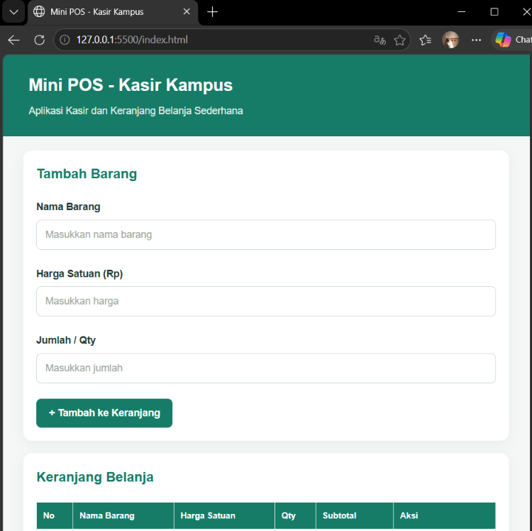
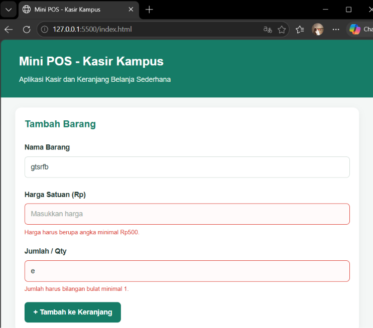
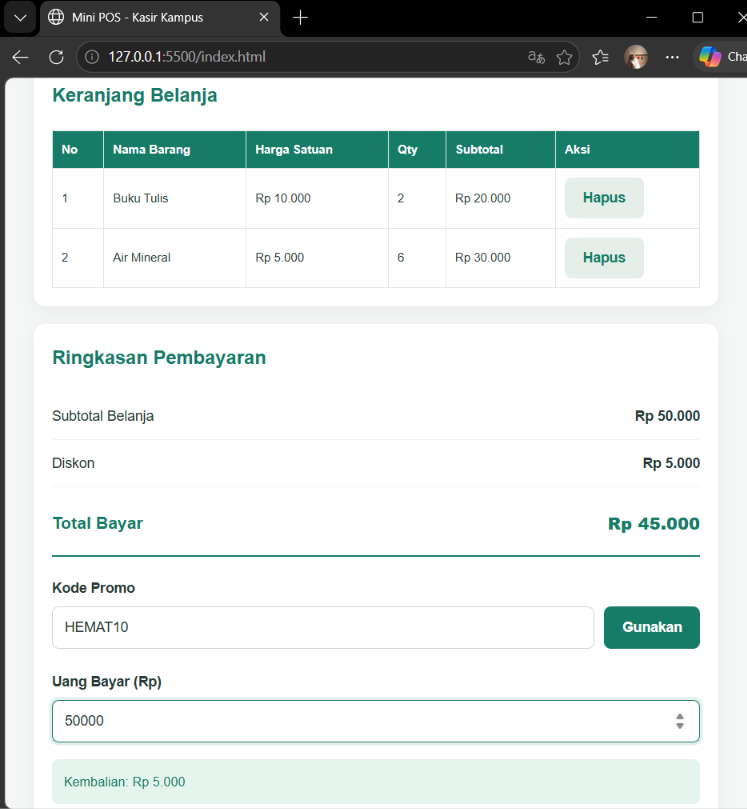
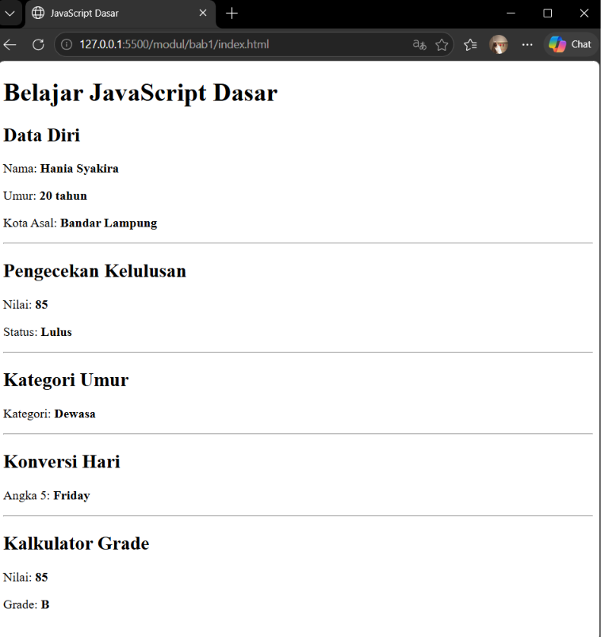
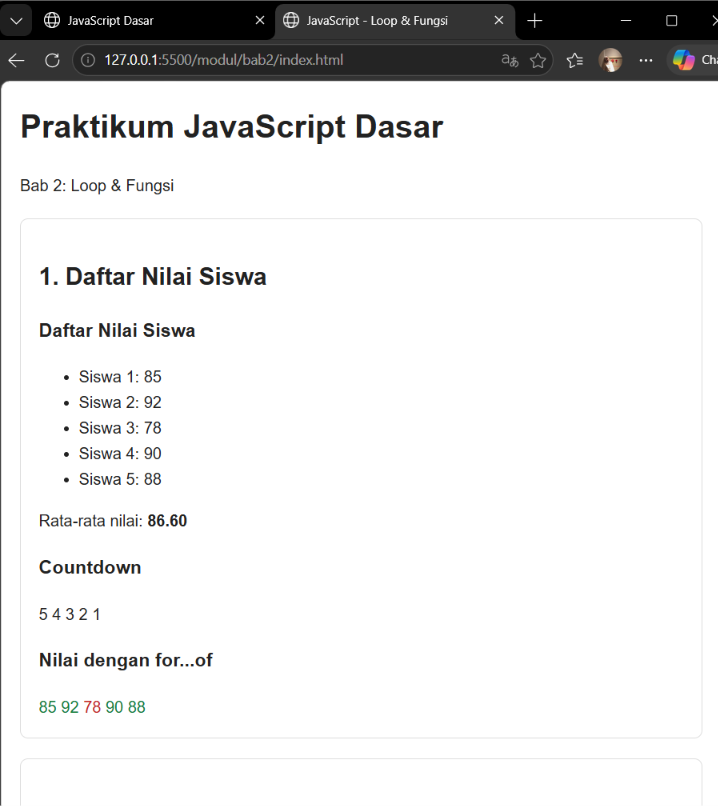
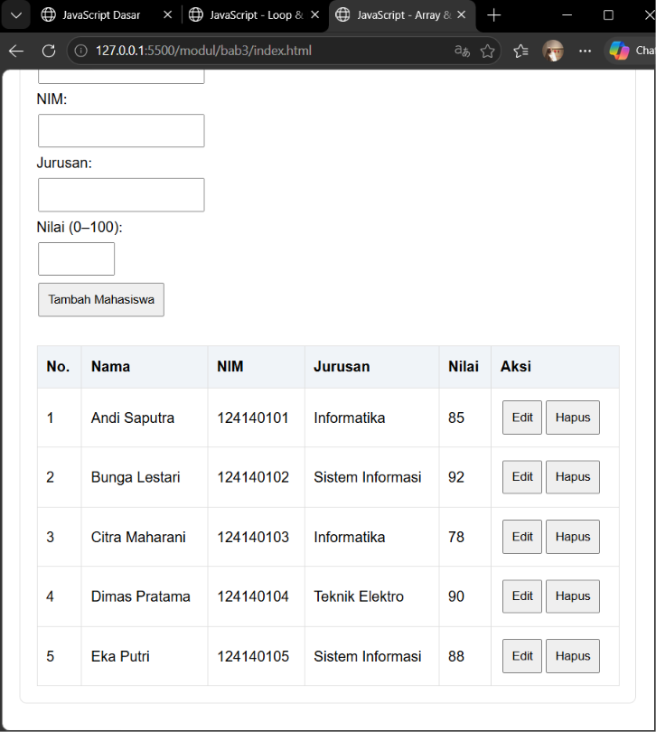
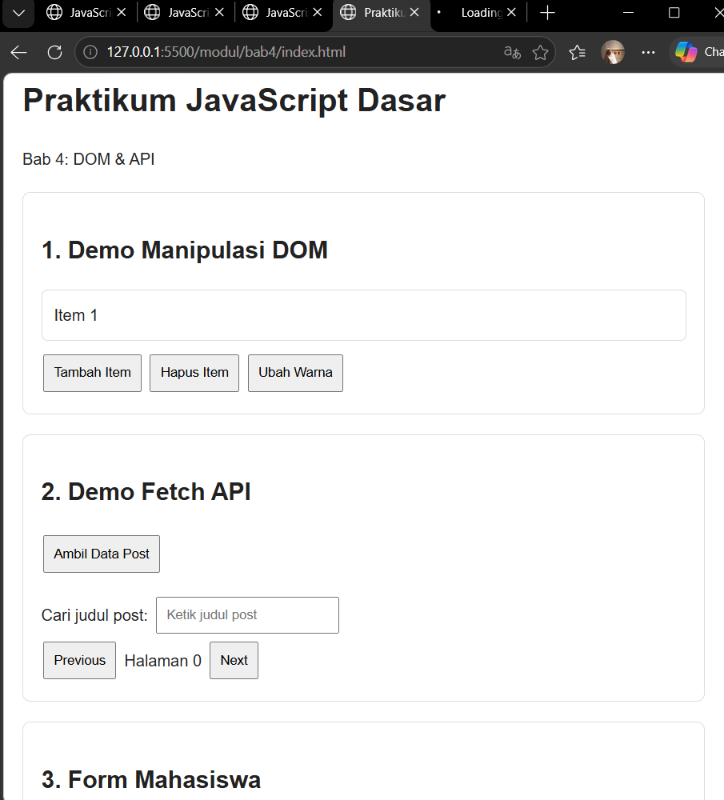

# Praktikum Pemrograman Web

## Identitas Mahasiswa

- **Nama:** Hania Syakira
- **NIM:** 124140114
- **Kelas:** PAW RA
- **Mata Kuliah:** Pemrograman Web

## Deskripsi

Repository ini berisi hasil praktikum Pemrograman Web yang terdiri dari proyek Mini POS (Point of Sale) dan latihan JavaScript Bab 1 sampai Bab 4. Praktikum mencakup JavaScript dasar, perulangan dan fungsi, array dan objek, serta manipulasi DOM dan penggunaan API.

## 1. Mini POS (Point of Sale)

Mini POS merupakan aplikasi kasir sederhana berbasis HTML, CSS, dan JavaScript untuk mengelola transaksi penjualan, menghitung total belanja, menerapkan diskon, dan menghitung uang kembalian.

### Fitur

- Validasi nama barang, harga minimal Rp500, dan jumlah barang.
- Menambahkan dan menghapus barang dari keranjang.
- Menghitung subtotal dan total belanja secara otomatis.
- Memberikan diskon 10% jika subtotal minimal Rp50.000 atau menggunakan kode promo `HEMAT10`.
- Menghitung total pembayaran setelah diskon.
- Menghitung uang kembalian atau menampilkan informasi jika pembayaran kurang.
- Menyimpan data keranjang menggunakan `localStorage`.
- Menghapus data transaksi saat memulai transaksi baru.

### Screenshot Mini POS

**Tampilan Utama**



**Validasi Input**



**Hasil Perhitungan Transaksi**



## 2. Praktikum Bab 1 — JavaScript Dasar

Bab ini mempelajari konsep dasar JavaScript, variabel, tipe data, output, operator, dan struktur kondisional.

### Materi dan Latihan

- Penggunaan `let` dan `const`.
- Menampilkan output menggunakan `console.log()` dan `innerHTML`.
- Percabangan `if`, `else if`, dan `else`.
- Penggunaan operator ternary.
- Penggunaan `switch` untuk menentukan nama hari.
- Pengecekan kelulusan berdasarkan nilai.
- Penentuan kategori usia.
- Pembuatan program kalkulator nilai mahasiswa.

### Screenshot Bab 1



## 3. Praktikum Bab 2 — Perulangan dan Fungsi

Bab ini membahas penggunaan perulangan dan fungsi untuk membuat program yang lebih terstruktur dan efisien.

### Materi dan Latihan

- Perulangan menggunakan `for`, `while`, dan `for...of`.
- Penggunaan fungsi JavaScript.
- Pembuatan tabel perkalian 1–10.
- Perhitungan faktorial.
- Pengecekan bilangan prima.
- Pembuatan kalkulator BMI.
- Penerapan program FizzBuzz dari 1 sampai 100.
- Penggunaan event handler untuk menjalankan fungsi.

### Screenshot Bab 2



## 4. Praktikum Bab 3 — Array dan Objek

Bab ini mempelajari penyimpanan dan pengolahan kumpulan data menggunakan array dan objek JavaScript.

### Materi dan Latihan

- Membuat array dan objek mahasiswa.
- Menggunakan metode array `push()`, `pop()`, `sort()`, `map()`, dan `filter()`.
- Menampilkan data mahasiswa dalam tabel HTML.
- Mencari mahasiswa dengan nilai tertinggi.
- Memfilter mahasiswa berdasarkan nilai rata-rata.
- Mengurutkan nama mahasiswa secara ascending dan descending.
- Membuat fitur CRUD (*Create, Read, Update, Delete*) untuk mengelola data mahasiswa.

### Screenshot Bab 3



## 5. Praktikum Bab 4 — DOM dan API

Bab ini membahas manipulasi Document Object Model (DOM), penyimpanan data pada browser, dan pengambilan data dari API.

### Materi dan Latihan

- Memanipulasi elemen HTML menggunakan DOM.
- Membuat form mahasiswa dengan validasi input.
- Menyimpan data menggunakan `localStorage`.
- Mengambil data dari API menggunakan Fetch API dan `async/await`.
- Mencari dan memfilter data berdasarkan judul.
- Membuat fitur pagination dengan tombol Previous dan Next.
- Membuat fitur dark mode.
- Membuat aplikasi Todo List dengan fitur tambah, hapus, dan tandai tugas selesai.

### Screenshot Bab 4



## Struktur Folder

```text
Hania Syakira_124140114_pertemuan1/
├── index.html
├── style.css
├── script.js
├── README.md
├── screenshot/
│   ├── tampilan-utama.png
│   ├── validasi-error.png
│   └── hasil-perhitungan.png
└── modul/
    ├── bab1/
    │   ├── index.html
    │   ├── script.js
    │   └── screenshot/
    │       └── bab1-javascript-dasar.png
    ├── bab2/
    │   ├── index.html
    │   ├── script.js
    │   └── screenshot/
    │       └── bab2-loop-fungsi.png
    ├── bab3/
    │   ├── index.html
    │   ├── script.js
    │   └── screenshot/
    │       └── bab3-array-objek.png
    └── bab4/
        ├── index.html
        ├── script.js
        └── screenshot/
            └── bab4-dom-api.png
```

## Cara Menjalankan Program

### Mini POS

1. Buka folder proyek di Visual Studio Code.
2. Buka file `index.html` menggunakan browser.
3. Alternatifnya, gunakan ekstensi Live Server pada Visual Studio Code.
4. Masukkan data barang untuk mencoba fitur transaksi.

### Praktikum Bab 1–4

1. Buka folder `modul`.
2. Pilih folder bab yang ingin dijalankan.
3. Buka file `index.html` pada bab tersebut menggunakan browser atau Live Server.
4. Ikuti instruksi pada halaman untuk mencoba setiap latihan.
5. Pastikan koneksi internet tersedia ketika menjalankan latihan yang menggunakan Fetch API.

## Penjelasan Teknis

- **HTML** digunakan untuk membangun struktur halaman.
- **CSS** digunakan untuk mengatur tampilan dan tata letak.
- **JavaScript** digunakan untuk mengolah data, menjalankan logika program, melakukan validasi, dan menangani interaksi pengguna.
- **DOM** digunakan untuk mengakses dan memanipulasi elemen HTML.
- **localStorage** digunakan untuk menyimpan data pada browser agar tetap tersedia setelah halaman dimuat ulang.
- **Fetch API** digunakan untuk mengambil data dari layanan API eksternal.

## Kesimpulan

Melalui praktikum ini, mahasiswa mempelajari penerapan HTML, CSS, dan JavaScript dalam pembuatan aplikasi web sederhana. Mini POS menerapkan validasi, pengelolaan keranjang, perhitungan transaksi, diskon, pembayaran, dan penyimpanan data. Praktikum Bab 1–4 memperkuat pemahaman mengenai dasar JavaScript, perulangan, fungsi, array, objek, DOM, `localStorage`, dan Fetch API.
