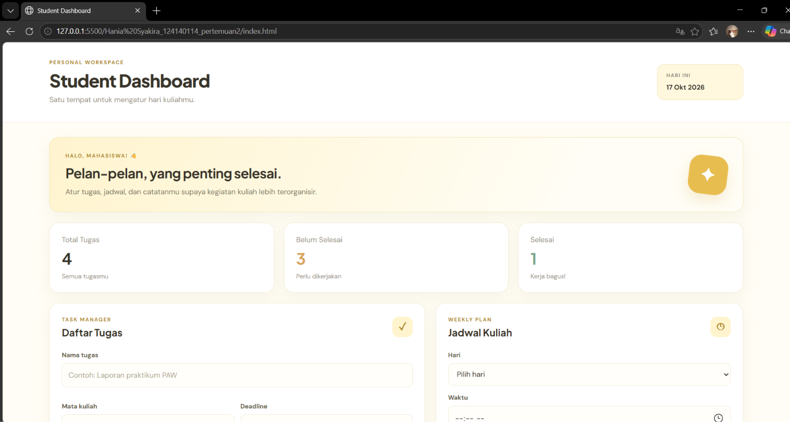
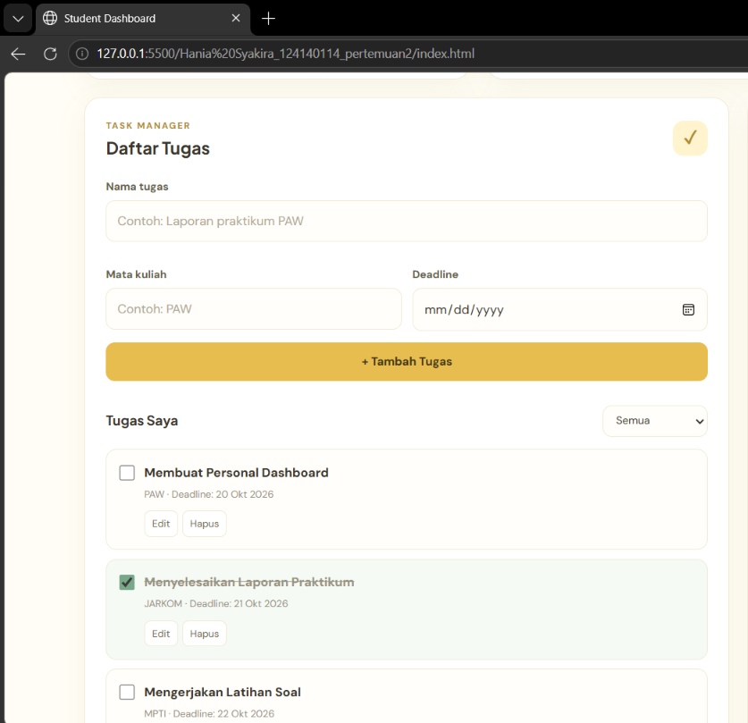
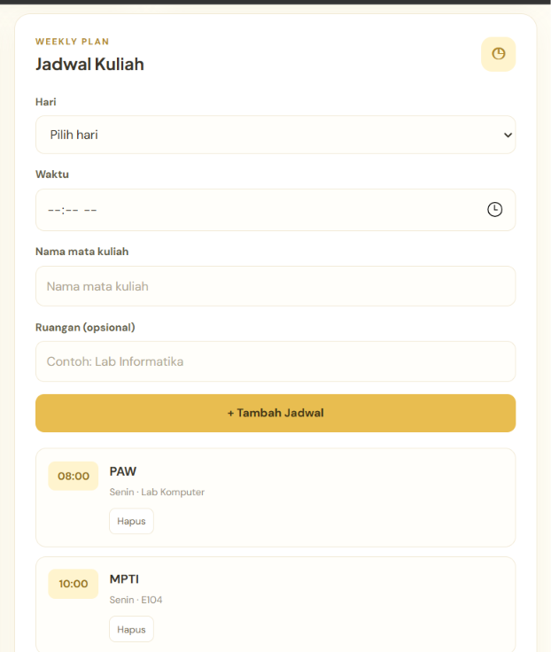
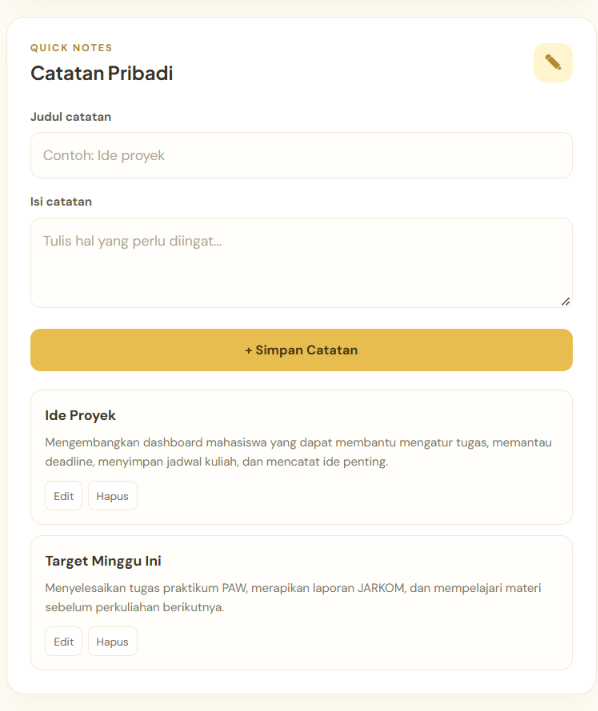

# Pertemuan 2 — Personal Dashboard

## Deskripsi
Personal Dashboard adalah aplikasi web sederhana untuk membantu mahasiswa mengelola tugas kuliah, jadwal perkuliahan, dan catatan pribadi dalam satu halaman.

## Fitur Aplikasi
- Menambahkan, mengedit, dan menghapus tugas.
- Menandai tugas yang sudah selesai.
- Menampilkan ringkasan tugas.
- Menambahkan dan menghapus jadwal kuliah.
- Menambahkan, mengedit, dan menghapus catatan pribadi.
- Menampilkan tanggal saat ini.
- Menampilkan kutipan inspirasi dari API.
- Menyimpan data menggunakan localStorage.

## Teknologi
- HTML5
- CSS3
- JavaScript ES6+
- localStorage
- Fetch API

## Screenshot

### 1. Dashboard Utama

### 2. Manajemen Tugas

### 3. Jadwal Kuliah

### 4. Catatan Pribadi

## Implementasi ES6+

| Fitur | Keterangan | Baris Kode |
|---|---|---|
| let dan const | Deklarasi variabel dan konstanta | Sesuaikan |
| Arrow Function | Fungsi dengan sintaks panah | Sesuaikan |
| Template Literals | Membuat teks dinamis | Sesuaikan |
| Class | Menggunakan TaskItem dan DashboardApp | Sesuaikan |
| Destructuring | Mengambil properti objek | Sesuaikan |
| Spread Operator | Menyalin dan memperbarui array/objek | Sesuaikan |
| Async/Await | Mengambil kutipan secara asynchronous | Sesuaikan |
| Promise dan Fetch API | Mengambil data dari API | Sesuaikan |

## Penyimpanan Data
Data tugas, jadwal kuliah, dan catatan disimpan menggunakan localStorage agar tetap tersedia setelah halaman dimuat ulang.

## Identitas
- **Nama:** Hania Syakira
- **NIM:** 124140114
- **Mata Kuliah:** Pemrograman Aplikasi Web
- **Pertemuan:** 2
