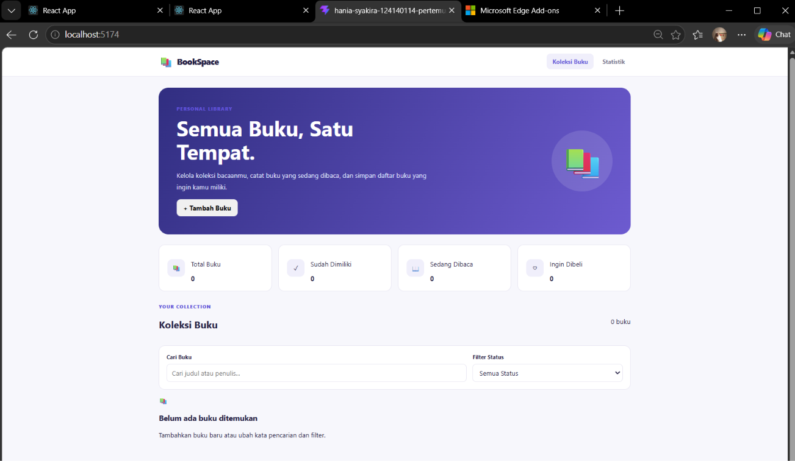
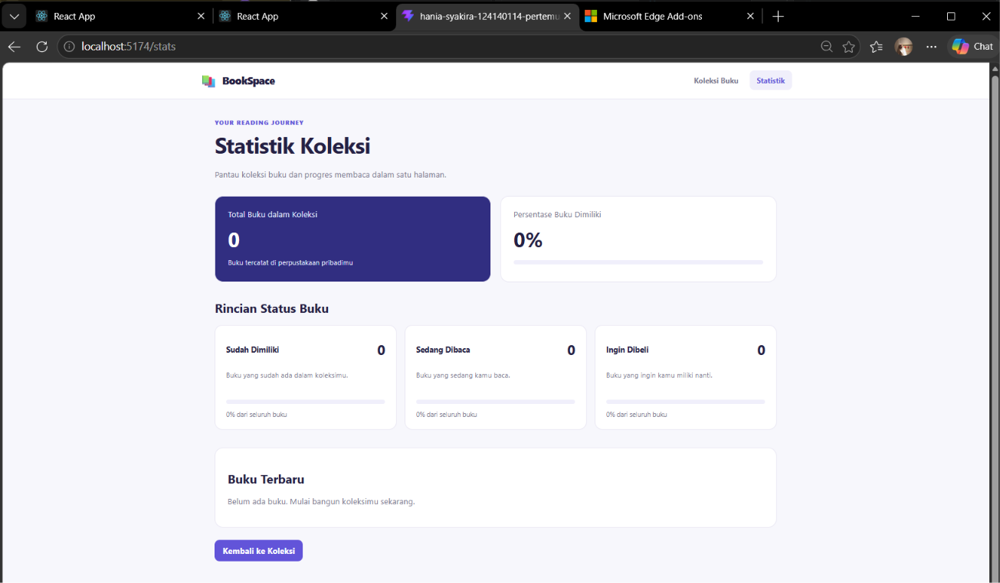

# 📚 BookSpace — Aplikasi Manajemen Buku Pribadi

BookSpace adalah aplikasi berbasis web yang dikembangkan menggunakan React untuk membantu pengguna mengelola koleksi buku pribadi. Aplikasi ini memungkinkan pengguna menambahkan, melihat, mengedit, menghapus, mencari, dan memfilter buku berdasarkan status kepemilikan atau aktivitas membaca.

Aplikasi ini dibuat sebagai tugas praktikum Pemrograman Web dengan menerapkan konsep React, React Hooks, Context API, React Router, custom hooks, PropTypes, localStorage, dan unit testing.

---

## 📌 Daftar Isi

1. Deskripsi Aplikasi
2. Tujuan Pengembangan
3. Fitur Aplikasi
4. Teknologi yang Digunakan
5. Instalasi dan Cara Menjalankan Aplikasi
6. Screenshot Antarmuka
7. Penjelasan Konsep React
8. Struktur Project
9. Pengujian Aplikasi
10. Dokumentasi Testing
11. Penyimpanan Data
12. Pengembang

---

## 1. Deskripsi Aplikasi

BookSpace merupakan aplikasi manajemen buku pribadi yang dirancang agar pengguna dapat mengatur koleksi buku dalam satu tempat. Setiap buku memiliki informasi berupa judul, nama penulis, status buku, dan catatan tambahan.

Aplikasi menyediakan halaman koleksi buku dan halaman statistik. Pada halaman koleksi, pengguna dapat mengelola data buku melalui operasi CRUD (Create, Read, Update, Delete). Pengguna juga dapat mencari buku berdasarkan judul atau nama penulis dan memfilter daftar berdasarkan status buku.

Halaman statistik menyajikan ringkasan jumlah buku, jumlah buku berdasarkan status, persentase buku yang dimiliki, serta daftar buku terbaru. Data buku disimpan menggunakan localStorage sehingga tetap tersedia ketika halaman dimuat ulang pada browser yang sama.

## 2. Tujuan Pengembangan

Tujuan pengembangan BookSpace adalah:

- Menerapkan konsep dasar dan lanjutan React dalam aplikasi web.
- Mengimplementasikan operasi CRUD untuk pengelolaan data buku.
- Menggunakan React Hooks untuk mengelola state dan efek samping.
- Menerapkan Context API untuk berbagi data antarkomponen.
- Menggunakan React Router untuk navigasi beberapa halaman.
- Menerapkan custom hooks untuk penggunaan logika yang dapat digunakan kembali.
- Memanfaatkan localStorage untuk menyimpan data pada browser.
- Menerapkan PropTypes untuk validasi tipe props.
- Menguji fungsi komponen menggunakan unit testing.

## 3. Fitur Aplikasi

### 3.1. Menambahkan Buku

Pengguna dapat menambahkan buku dengan mengisi judul, nama penulis, status buku, dan catatan opsional. Judul dan nama penulis wajib diisi.

### 3.2. Melihat Koleksi Buku

Aplikasi menampilkan daftar buku yang telah tersimpan. Setiap item menampilkan judul, nama penulis, status, dan catatan jika tersedia.

### 3.3. Mengedit Buku

Pengguna dapat memperbarui informasi buku yang sudah tersimpan. Formulir akan menampilkan data buku yang dipilih agar dapat diedit.

### 3.4. Menghapus Buku

Pengguna dapat menghapus buku dari koleksi. Aplikasi menampilkan konfirmasi sebelum data dihapus.

### 3.5. Pencarian Buku

Pengguna dapat mencari buku menggunakan judul atau nama penulis. Hasil pencarian diperbarui sesuai kata kunci yang dimasukkan.

### 3.6. Filter Status Buku

Pengguna dapat memfilter koleksi berdasarkan kategori berikut:

- **Sudah Dimiliki (`milik`)**: buku yang telah dimiliki.
- **Sedang Dibaca (`baca`)**: buku yang sedang dibaca.
- **Ingin Dibeli (`beli`)**: buku yang ingin dimiliki.

Pengguna juga dapat menampilkan semua buku tanpa filter status.

### 3.7. Statistik Koleksi

Halaman statistik menampilkan total buku, jumlah buku pada setiap status, persentase buku yang dimiliki, serta daftar hingga lima buku terbaru.

### 3.8. Penyimpanan Otomatis

Data buku disimpan ke localStorage sehingga data tetap tersedia setelah halaman dimuat ulang, selama data browser tidak dihapus.

### 3.9. Validasi Formulir

Aplikasi menampilkan pesan kesalahan jika judul atau nama penulis belum diisi. Hal ini membantu memastikan data penting tersedia sebelum disimpan.

### 3.10. Navigasi Multi-Halaman

Aplikasi menyediakan halaman Koleksi Buku dan Statistik. Jika pengguna membuka rute yang tidak tersedia, aplikasi menampilkan halaman tidak ditemukan.

---

## 4. Teknologi yang Digunakan

| Teknologi | Kegunaan |
|---|---|
| React | Membangun antarmuka berbasis komponen |
| JavaScript | Mengimplementasikan logika aplikasi |
| Vite | Menjalankan server pengembangan dan proses build |
| React Router | Mengatur navigasi dan rute halaman |
| React Context API | Membagikan data buku dan fungsi CRUD |
| React Hooks | Mengelola state dan efek samping |
| PropTypes | Memvalidasi tipe props komponen |
| localStorage | Menyimpan data buku pada browser |
| Vitest | Menjalankan unit test |
| React Testing Library | Menguji perilaku komponen dari sisi pengguna |
| jsdom | Menyediakan lingkungan DOM untuk pengujian |

---

## 5. Instalasi dan Cara Menjalankan Aplikasi

### 5.1. Persyaratan

Pastikan perangkat telah memiliki:

- Node.js.
- npm.
- Visual Studio Code atau editor kode lainnya.
- Browser seperti Google Chrome atau Microsoft Edge.

### 5.2. Membuka Project

Buka folder project `Hania_Syakira_124140114_pertemuan3` melalui Visual Studio Code.

Buka terminal di dalam folder tersebut. Pastikan terminal berada pada direktori yang berisi file `package.json`.

### 5.3. Menginstal Dependensi

Jalankan perintah berikut:

```bash
npm install
```

Jika menggunakan Windows PowerShell dan perintah `npm` terhalang kebijakan eksekusi script, gunakan:

```powershell
npm.cmd install
```

### 5.4. Menjalankan Aplikasi

Jalankan perintah berikut:

```bash
npm run dev
```

Pada Windows PowerShell, alternatifnya:

```powershell
npm.cmd run dev
```

Vite akan menampilkan alamat lokal di terminal, misalnya:

```text
Local: http://localhost:5173/
```

Buka alamat yang benar-benar ditampilkan pada terminal. Jika port tersebut sedang digunakan, Vite dapat memilih port lain, misalnya `5174`.

### 5.5. Menjalankan Unit Test

Untuk menjalankan seluruh unit test:

```bash
npm run test
```

Pada Windows PowerShell:

```powershell
npm.cmd test
```

### 5.6. Membuat Build Produksi

Untuk memeriksa apakah aplikasi dapat dibangun untuk produksi, jalankan:

```bash
npm run build
```

Pada Windows PowerShell:

```powershell
npm.cmd run build
```

Jika proses berhasil, Vite akan menghasilkan folder `dist`.

---

## 6. Screenshot Antarmuka

Screenshot berikut menunjukkan tampilan halaman utama dan halaman statistik BookSpace.

### 6.1. Halaman Beranda dan Koleksi Buku

Halaman beranda menampilkan navigasi, informasi pengantar aplikasi, ringkasan statistik koleksi, formulir pengelolaan buku, pencarian, filter status, dan daftar buku.



### 6.2. Halaman Statistik Koleksi

Halaman statistik menampilkan jumlah seluruh buku, persentase buku yang dimiliki, rincian status buku, serta daftar buku terbaru.



---

## 7. Penjelasan Konsep React yang Digunakan

### 7.1. Functional Components

Aplikasi menggunakan functional components untuk membagi antarmuka menjadi bagian yang lebih kecil dan mudah dikelola.

Contohnya:

- `BookForm`: formulir tambah dan edit buku.
- `BookList`: menampilkan daftar buku.
- `BookFilter`: menyediakan pencarian dan filter.
- `Home`: halaman utama koleksi.
- `Stats`: halaman statistik.

Penggunaan komponen membuat kode lebih terstruktur dan memungkinkan komponen digunakan kembali.

### 7.2. useState

`useState` digunakan untuk menyimpan dan memperbarui state yang dibutuhkan aplikasi.

Contoh penggunaannya terdapat pada:

- Nilai input formulir buku.
- Kata kunci pencarian.
- Status filter yang dipilih.
- Data buku yang sedang diedit.
- Status tampil atau tutup formulir.
- Pesan umpan balik kepada pengguna.

### 7.3. useEffect

`useEffect` digunakan untuk menjalankan efek samping setelah proses render.

Pada aplikasi ini, `useEffect` digunakan untuk:

- Menyinkronkan data dengan localStorage.
- Mengatur nilai formulir ketika buku yang diedit berubah.

### 7.4. Context API

Context API digunakan untuk menyediakan data buku dan fungsi pengelolaannya kepada komponen yang membutuhkan tanpa harus meneruskan props melalui setiap tingkat komponen.

Implementasinya terdapat pada `src/context/BookContext.jsx`.

Context menyediakan:

- Daftar buku.
- Fungsi menambahkan buku.
- Fungsi memperbarui buku.
- Fungsi menghapus buku.
- Statistik koleksi.

`BookProvider` membungkus bagian aplikasi yang membutuhkan data tersebut, sedangkan custom hook `useBooks` digunakan untuk mengakses context.

### 7.5. React Router

React Router digunakan untuk navigasi ant halaman tanpa harus membuat aplikasi terpisah.

Rute yang tersedia:

| Rute | Halaman |
|---|---|
| `/` | Koleksi Buku |
| `/stats` | Statistik |
| Rute lainnya | Halaman tidak ditemukan |

Komponen yang digunakan antara lain `BrowserRouter`, `Routes`, `Route`, `NavLink`, dan `Link`.

### 7.6. Custom Hooks

Aplikasi menggunakan dua custom hooks untuk memisahkan logika yang dapat digunakan kembali.

**a. `useLocalStorage.js`**

Custom hook ini mengelola pembacaan dan penyimpanan data pada localStorage. Nilai awal dibaca dari penyimpanan browser, kemudian diperbarui ketika state berubah.

**b. `useBookStats.js`**

Custom hook ini menghitung statistik koleksi berdasarkan status buku, meliputi total buku, jumlah buku yang dimiliki, jumlah buku yang sedang dibaca, jumlah buku yang ingin dibeli, dan persentase buku yang dimiliki.

Hook ini menggunakan `useMemo` agar perhitungan dilakukan kembali ketika daftar buku berubah.

### 7.7. PropTypes

PropTypes digunakan untuk memvalidasi tipe props yang diterima komponen.

Contohnya, `BookList` menerima array objek buku beserta fungsi untuk mengedit dan menghapus buku. Validasi membantu menemukan ketidaksesuaian tipe props selama pengembangan.

### 7.8. localStorage

localStorage digunakan untuk menyimpan daftar buku dalam format JSON di browser.

Penyimpanan dilakukan secara otomatis ketika state buku berubah. Dengan demikian, data dapat tetap tersedia setelah halaman dimuat ulang pada browser yang sama.

### 7.9. Unit Testing

Unit testing digunakan untuk memeriksa perilaku komponen secara terpisah.

Pengujian dilakukan menggunakan Vitest dan React Testing Library. Pengujian berfokus pada tampilan formulir, validasi input, pengiriman data buku, serta interaksi pencarian dan filter status.

---

## 8. Struktur Project

Struktur utama project adalah sebagai berikut:

```text
Hania_Syakira_124140114_pertemuan3/
├── screenshots/
│   ├── beranda-bookspace.png
│   └── statistik-bookspace.png
├── src/
│   ├── components/
│   │   ├── BookForm/
│   │   │   ├── BookForm.jsx
│   │   │   ├── BookForm.css
│   │   │   └── BookForm.test.jsx
│   │   ├── BookList/
│   │   │   ├── BookList.jsx
│   │   │   └── BookList.css
│   │   └── BookFilter/
│   │       ├── BookFilter.jsx
│   │       ├── BookFilter.css
│   │       └── BookFilter.test.jsx
│   ├── context/
│   │   └── BookContext.jsx
│   ├── hooks/
│   │   ├── useLocalStorage.js
│   │   └── useBookStats.js
│   ├── pages/
│   │   ├── Home/
│   │   │   ├── Home.jsx
│   │   │   └── Home.css
│   │   └── Stats/
│   │       ├── Stats.jsx
│   │       └── Stats.css
│   ├── App.jsx
│   ├── App.css
│   ├── index.css
│   ├── main.jsx
│   └── setupTests.js
├── index.html
├── package.json
├── package-lock.json
├── vite.config.js
└── README.md
```

---

## 9. Pengujian Aplikasi

Pengujian dilakukan menggunakan Vitest dan React Testing Library.

File pengujian yang tersedia:

- `src/components/BookForm/BookForm.test.jsx`
- `src/components/BookFilter/BookFilter.test.jsx`

### 9.1. Skenario Pengujian BookForm

| No. | Skenario | Hasil yang Diharapkan |
|---|---|---|
| 1 | Menampilkan formulir tambah buku | Judul formulir dan input tampil |
| 2 | Mengirim formulir kosong | Pesan validasi ditampilkan |
| 3 | Mengirim data buku valid | Fungsi pengiriman menerima data yang benar |
| 4 | Membuka formulir edit | Data buku tampil pada input |

### 9.2. Skenario Pengujian BookFilter

| No. | Skenario | Hasil yang Diharapkan |
|---|---|---|
| 1 | Menampilkan kontrol filter | Input pencarian dan pilihan status tampil |
| 2 | Mengubah kata pencarian | Callback pencarian menerima kata kunci baru |
| 3 | Mengubah status filter | Callback filter menerima status baru |

Terdapat **7 unit test** yang dirancang untuk menguji perilaku formulir dan filter. Status kelulusan aktual harus dipastikan dengan menjalankan perintah `npm.cmd test`.

---

## 10. Dokumentasi Testing

Screenshot hasil eksekusi unit test di terminal perlu disimpan sebagai bukti pengujian.

### Langkah pengambilan screenshot

1. Buka terminal di Visual Studio Code.
2. Jalankan:

   ```powershell
   npm.cmd test
   ```

3. Tunggu sampai seluruh pengujian selesai.
4. Pastikan hasil menunjukkan semua test berhasil.
5. Ambil screenshot terminal yang memperlihatkan jumlah test dan status kelulusannya.
6. Simpan screenshot pada folder `screenshots/` dengan nama `hasil-testing.png`.

Jika pengujian gagal, perbaiki error terlebih dahulu dan jalankan kembali pengujian.

Setelah screenshot tersedia, tambahkan bagian berikut pada README:

```md
### 10.1. Hasil Eksekusi Unit Test

Screenshot berikut merupakan bukti hasil eksekusi unit test menggunakan Vitest.


```

**Catatan:** file `hasil-testing.png` harus benar-benar dibuat dari screenshot terminal setelah pengujian dijalankan. Jangan membuat atau menggunakan gambar simulasi sebagai bukti pengujian.

---

## 11. Penyimpanan Data

Data buku disimpan pada localStorage browser menggunakan key:

```text
personal-books
```

Informasi yang disimpan meliputi:

- ID buku.
- Judul buku.
- Nama penulis.
- Status buku.
- Catatan tambahan.
- Waktu pencatatan buku.

Data disimpan dalam format JSON. Penyimpanan ini bersifat lokal pada browser dan bukan database server. Data dapat hilang jika pengguna menghapus data penyimpanan browser.

---

## 12. Pengembang

**Nama:** Hania Syakira  
**NIM:** 124140114  
**Mata Kuliah:** Pemrograman Web  
**Nama Aplikasi:** BookSpace — Aplikasi Manajemen Buku Pribadi

---

## Kesimpulan

BookSpace merupakan aplikasi manajemen buku pribadi berbasis React yang menerapkan pengelolaan data melalui operasi CRUD, pencarian, filter, statistik koleksi, serta penyimpanan data menggunakan localStorage.

Pengembangan aplikasi juga menerapkan Context API, React Router, custom hooks, PropTypes, dan unit testing untuk menghasilkan struktur kode yang modular dan mudah dikembangkan.
